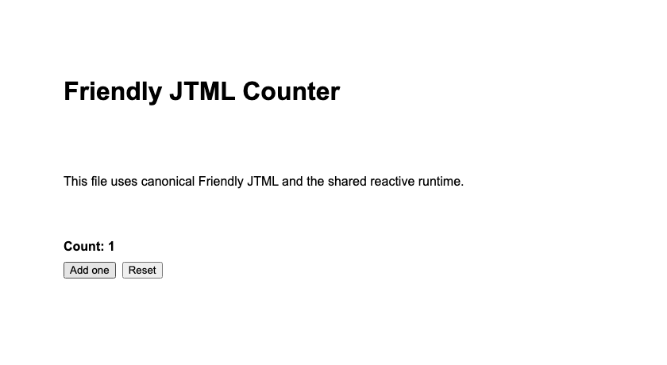

# JTML

JTML is an **experimental compiler-driven language for reactive web apps**.
Friendly JTML 2 puts observable state, actions and HTML-shaped UI in one readable
file. The C++17 compiler owns dependency analysis and generates static,
CSP-safe JavaScript; supported browser apps update locally without a JTML server.

[Build and try it](#get-started-from-source) · [v0.3 support and release status](docs/releases/v0.3-readiness.md) · [Architecture](https://github.com/mrjohnnyrocha/jtml/blob/main/ARCHITECTURE.md)

```jtml
jtml 2

let count = 0

when add
  count += 1

when reset
  count = 0

page class "friendly-counter" style "max-width: 680px; margin: 48px auto; padding: 28px; font-family: Arial, sans-serif; display: grid; gap: 16px"
  h1 "Friendly JTML Counter"
  p "This file uses canonical Friendly JTML and the shared reactive runtime."

  section style "display: grid; gap: 10px"
    strong "Count: {count}"
    box style "display: flex; gap: 8px; flex-wrap: wrap"
      button "Add one" click add
      button "Reset" click reset
```

This is the complete source of [the counter example](examples/friendly_counter.jtml)
built by the quickstart below. The screenshot shows the compiled application after
clicking **Add one** once, so it displays **Count: 1**.



**Research preview in development, not production-ready.** The proposed milestone
is v0.3.0; no v0.3 release is published. Current CLI/C API builds report
**0.3.0-dev**; CPack and CLI archive identities use the same full version.
The editor source remains independently versioned at **0.2.0** (no VSIX is shipped).
Validated component-argument repairs and remaining native-renderer limitations are
recorded in the [independent readiness report](docs/releases/v0.3-readiness.md).

## Get started from source

Use Git, a C++17 compiler and a recent CMake (validated with **3.31.3**).
Configure downloads SHA256-pinned WebSocket++ 0.8.2 and Asio 1.30.2, requiring
network access or a populated cache. Python 3 below serves static files only.
Python bindings and tests are not needed for this quickstart.

```sh
git clone https://github.com/mrjohnnyrocha/jtml.git
cd jtml
cmake -S . -B build -DCMAKE_BUILD_TYPE=Release -DJTML_BUILD_PYTHON=OFF -DJTML_BUILD_TESTS=OFF
cmake --build build --target jtml_cli --parallel
./build/jtml --version
./build/jtml check examples/friendly_counter.jtml
./build/jtml build examples/friendly_counter.jtml --target browser --out dist/counter
python3 -m http.server 8000 --bind 127.0.0.1 --directory dist/counter
```

Open [localhost:8000](http://localhost:8000), try **Add one** and **Reset**, then
stop the static server with Ctrl+C. Keep all four generated assets together:
`index.html`, `jtml-runtime.js`, `components/index.js`, `app.js`.
No npm package or hosted JTML service is needed.

For the separate trusted-code, loopback-only live development backend:
`./build/jtml serve examples/friendly_counter.jtml --port 8000 --watch`.
Friendly is canonical; Classic is compatibility/embedding infrastructure and
`jtl 1` remains experimental. [Installation and packaging](docs/tooling/deployment.md)
have separate working-directory and version limits.

## License

Project-owned JTML source, documentation, examples, site and editor resources
are offered under [Apache License 2.0](LICENSE), SPDX **Apache-2.0**.
Third-party components retain their own licenses and notices; see
[THIRD_PARTY_NOTICES.md](THIRD_PARTY_NOTICES.md). This does not relicense dependencies.
License adoption and provenance are subject to the owner's review before merge;
no new copyright holder or year is asserted by this PR.

## Syntax

The canonical source dialect is Friendly JTML 2. Start files with `jtml 2`,
write indentation-based blocks, and use HTML-shaped element names without
closing tags:

```jtml
jtml 2

let count = 0
get doubled = count * 2

when add
  count += 1

page
  h1 "Counter"
  show "Count: {count}"
  text "Doubled: {doubled}"
  button "Add" click add
```

Try it with:

```sh
./build/jtml serve examples/friendly_counter.jtml --port 8000
```

Friendly syntax is the format used by the tutorial, Studio samples, AI
authoring contract, formatter, and bundled app examples. The Classic-compatible
backend remains supported for existing files, migration, embedding, and
compiler artifacts, but it is not the public authoring style for new apps.

For core-language experiments without web UI, use `jtl 1`:

```jtl
jtl 1

let total = 0
get doubled = total * 2

when add amount
  total += amount
```

This is an early compatibility slice: `jtl 1` currently lowers through the
Friendly pipeline. There is no mature standalone JTL parser, type system,
standard library, backend runtime, or contract-first API system yet. A
dedicated core runtime, `fn` functions, tests, standard library, and
Python/JS/native interop are design/future work in
`docs/architecture/language-family-design.md`.

Hyphenated attributes such as `data-page` and `aria-label` are supported.
Keyword-shaped attributes such as `for` are supported in element position, and
boolean attributes can be written naturally:

```jtml
jtml 2

page class "profile" data-page "home"
  label for "email" aria-label "Email"
    show "Email"
  input "Email" id "email" type "email" required
  my-widget data-mode "compact"
    text "Custom element"
```

Browser events use Friendly event sugar in `jtml 2` files: `click`, `input`,
`change`, `submit`, `hover`, `scroll`, `focus`, `blur`, `keyup`, `keydown`,
`key-up`, `key-down`, `dragover`, `drop`, `dblclick`, and `double-click`.

```jtml
let email = ""
let saved = false

when save
  if email != ""
    saved = true

page
  input "Email" into email
  button "Save" click save
  if saved
    text "Saved {email}"
```

The syntax also includes imports, fetches, and routes. These surfaces have
partial implementations; this sketch needs the referenced component and an
application-provided API, and is not a standalone getting-started example:

```jtml
use Card from "./components/card.jtml"

let users = fetch "/api/users" stale keep retry 2

route "/" as Home
route "/users/:id" as User

make Home
  page
    h1 "Users"
    for user in users.data
      Card user.name

make User id
  page
    h1 "User {id}"
```

## Compatibility Backend

Classic syntax is still accepted for older files and generated compiler
artifacts. It uses `define`, `derive`, `function`, `@tag`, `\`, and `#`:

```jtml
define name = "Alice"\\
derive greeting = "Hello, " + name\\
@main\\
    show greeting\\
#
```

Use this form only when maintaining old code, testing migration, embedding
through compatibility APIs, or inspecting lowered artifacts.

## Reserved Keywords

Friendly JTML 2 reserves the current public language surface. The most useful
groups are:

```text
state: let const get show
actions: when effect store extern redirect refresh invalidate
components: make slot export use
flow: if else for in while break continue try catch finally return throw
data: fetch method body cache credentials timeout retry stale keep group key
      cache-key cacheKey dedupe every revalidate background lazy load
routes: route layout guard require activeRoute activeRouteName
forms/events: into click input change submit hover scroll focus blur keyup
        keydown key-up key-down dragover drop dblclick double-click
styles: theme style css raw app shell topbar sidebar content panel card grid
        stack cluster split toolbar tabs tab alert badge modal drawer toast
        loading error empty field metric spacer cols gap pad radius shadow tone
        align justify width surface
elements/media: page link navlink text box image video audio embed file
        dropzone canvas svg graphic group bar dot line path polyline polygon
        svgtext chart scene3d checkbox list ordered item
media helpers: timeline animate resize crop filter axis legend grid stacked
        values series colors min max ticks annotate export duration easing
        autoplay repeat
```

Classic compatibility also reserves the backend forms `element`, `define`,
`derive`, `unbind`, `function`, `async`, `subscribe`, `unsubscribe`, `object`,
`derives`, `import`, `main`, `then`, and `except`. Use those only in
compatibility examples or lowered artifact debugging.

## Build

```sh
cmake -S . -B build -DJTML_BUILD_PYTHON=OFF
cmake --build build --target jtml_cli
```

The build fetches pinned WebSocket++ 0.8.2 and standalone Asio 1.30.2 sources with verified hashes. See `third_party/` for vendored single-header deps (`json.hpp`, `cpp-httplib`).

## Repository Layout

```
include/jtml/    public headers, one namespace-style include root
src/             implementation files, matching public modules
cli/             `jtml` binary split by command
tests/           CMake/CTest unit tests
third_party/     vendored headers
cmake/           reusable CMake helpers
examples/        runnable `.jtml` programs
tutorial/        lesson content for `jtml tutorial`
editors/vscode/  VS Code extension assets
scripts/         optional integration bindings
docs/            language, deployment, and design documentation
site/            static project website
```

## Run

```sh
./build/jtml transpile examples/user_interactions.jtml -o example.html
./build/jtml serve examples/user_interactions.jtml --port 8000
```

For `jtml serve`, the generated page connects to the runtime WebSocket server on `--port + 80` and falls back to `POST /api/event` if WebSocket is unavailable. The same server exposes `/api/health`, `/api/bindings`, `/api/state`, and `/api/runtime` for IDEs, test runners, and external hosts; see `docs/tooling/runtime-http-contract.md`.

## Quick Start For End Users

After building, try the language from the repo root:

```sh
./build/jtml examples
./build/jtml demo --port 8000
```

Then open `http://localhost:8000`. `demo` starts JTML Studio: a real browser editor with Run, Lint, safe Fix, Friendly-preserving Format, Export HTML, diagnostics, versioned local Save/history, compiler artifacts, and live preview.

Check your install:

```sh
./build/jtml --version
./build/jtml keywords
./build/jtml ui
```

Create a starter page:

```sh
./build/jtml new my_page.jtml
./build/jtml check my_page.jtml
./build/jtml serve my_page.jtml --port 8000
```

Create a modular app:

```sh
./build/jtml new app my-app
cd my-app
jtml dev . --port 8000
```

Install a local JTML package into an app:

```sh
jtml add ../shared/card.jtml
jtml add ui-kit --from ../packages/ui-kit
```

Packages are copied into `jtml_modules/` and tracked in `jtml.packages.json`.
Friendly imports can use bare package names, for example
`use Card from "card"` or `use Button from "ui-kit"`. Named package imports
follow the same module rule as relative imports: the package entry must export
the requested public declaration, such as `export make Card`.

For a live development loop, add `--watch`. The source file is polled and any saved change re-transpiles, hot-swaps the interpreter, and broadcasts a reload to every connected browser — no extension, no script, no config:

```sh
./build/jtml serve my_page.jtml --port 8000 --watch
```

Export for existing apps:

```sh
./build/jtml export my_page.jtml --target html -o dist/index.html
./build/jtml export my_page.jtml --target react -o JtmlApp.jsx
./build/jtml export my_page.jtml --target vue -o JtmlApp.vue
./build/jtml export my_page.jtml --target custom-element -o jtml-app.js
```

Format and lint before committing:

```sh
./build/jtml fix my_page.jtml -w        # safe mechanical repairs
./build/jtml fmt my_page.jtml           # prints canonical source to stdout
./build/jtml fmt my_page.jtml -w        # rewrites the file in place
./build/jtml lint my_page.jtml          # reports undefined vars, unreachable code, etc.
./build/jtml test                       # smoke-tests every bundled example
```

`jtml fix` only applies low-risk source repairs: missing Friendly header, tab indentation, trailing whitespace, and final newline. `jtml fmt` is idempotent. Friendly files (`jtml 2`) are formatted with a source-preserving formatter that keeps high-level constructs such as `fetch`, `store`, and `route`; Classic files use the AST formatter with statements terminated by `\\`. `jtml check --json`, `jtml fix --json`, and `jtml lint --json` emit structured diagnostics for tools and AI agents. `jtml lint` exits non-zero when it finds errors, including obvious primitive type mismatches such as `let count: number = "zero"` and action arity mismatches such as `save(1)` for `when save id label`, so it is safe to use in pre-commit hooks or CI. The current linter is intentionally simple: some dynamic/runtime patterns may still need broader future checks.

Run the editor-neutral language server:

```sh
./build/jtml lsp
```

`jtml lsp` speaks the Language Server Protocol over stdio. It supports diagnostics, formatting, completions, hover, document/workspace symbols, cross-file definition, references, rename, code actions, signature help, document highlights, and selection ranges; see `docs/tooling/language-server.md`.

Semantic styling first slice is available through `theme`, UI primitives such
as `shell`, `panel`, `grid`, `card`, `metric`, and utility modifiers such as
`gap`, `pad`, `shadow`, `tone`, and `cols`. These lower to ordinary HTML,
generated CSS, and semantic IR counts in `jtml explain`.
Run `jtml ui --json` for the canonical primitive/modifier/theme-token catalog
used by docs, Studio examples, and tooling.
Use scoped `style` for page-local CSS, and explicit `css raw` / `html raw`
only when integrating trusted host widgets, custom elements, or third-party
surfaces that need direct platform markup. These escape hatches are reported
by semantic IR counts and `jtml lint` warnings for production review.

## AI-Native Authoring

JTML is designed to be a small, predictable target for AI-generated and AI-edited web apps. The contract for models and agents lives in `docs/reference/ai-authoring-contract.md`, and the implementation track lives in `docs/roadmaps/ai-native-implementation-roadmap.md`.

Recommended repair loop:

```sh
./build/jtml explain my_page.jtml --json
./build/jtml fix my_page.jtml -w
./build/jtml fmt my_page.jtml -w
./build/jtml check my_page.jtml
./build/jtml lint my_page.jtml
./build/jtml build my_page.jtml --out dist
```

`jtml explain --json` now includes an early semantic-analysis section sourced
from the parsed AST, including semantic node counts, structured route records,
dependency edges, and attribute kind counts for literal, boolean, reactive,
event, special, and passthrough attributes. It also reports imported modules in
`imports`, `semantic.nodes.imports`, raw escape hatches in
`semantic.nodes.rawCssBlocks` and `semantic.nodes.rawHtmlBlocks`, host interop
boundaries in `semantic.nodes.externs`, `semantic.routeRecords`,
`semantic.fetchRecords`, `semantic.componentDefinitions`,
`semantic.componentInstances`, and
`module --imports--> ...` / `extern:<name> --calls--> <window.path>` graph
edges. This is the first slice of the observable-first architecture: tooling
should explain language meaning before any particular runtime backend executes
it.

Browser builds use a separate compact runtime manifest. The client manifest is
script-escaped and omits source paths, component body source/hex payloads,
semantic summaries, and parse metadata that belong in `explain` output.

## Interactive Tutorial

The fastest way to learn the language is the built-in tutorial. It serves a split-view IDE in the browser: prose on top, editable code on the left, live preview on the right, and a `Run` button (or `Cmd/Ctrl+Enter`) that re-transpiles the code and hot-swaps the running interpreter.

```sh
./build/jtml tutorial --port 8000
```

Lessons live under `tutorial/<NN-slug>/{lesson.md, code.jtml}`. Adding a new lesson is just adding a new folder — no code changes required. The editor has JTML syntax highlighting, lesson navigation, and a `Cmd/Ctrl+Enter` run shortcut.

## Editor Support

A VS Code extension lives under `editors/vscode/`. It ships Friendly JTML 2 syntax highlighting, CLI-backed diagnostics, formatting, safe fixes, bracket matching, and snippets for app, component, fetch, route, store, effect, style, input, extern, and Classic fallback constructs. The native `jtml lsp` server is now available for editor clients that prefer LSP-powered diagnostics, formatting, completion, hover, and symbols. See `editors/vscode/README.md` for install instructions.

## Media And Graphics

JTML supports standards-based media today with `image`, `video`, `audio`,
`embed`, `file`, `dropzone`, SVG-first `graphic`/`bar`/`dot`/`line`/`path`,
accessible `chart bar` / `chart line` helpers with axes, legends, grid lines,
grouped series, stacked bars, and export controls, and `scene3d` 3D mount points, plus raw `canvas`/SVG-compatible tags and
explicit `extern`, `html raw`, and `css raw` bridges for host-provided graphics
or media libraries.
`video/audio ... into name` exposes playback state and client actions such as
`name.play`, `name.pause`, and `name.seek(0)`. `scene3d ... into sceneState`
exposes renderer/fallback state and lets host renderers publish updates through
`spec.update(...)`. Richer charts, 3D adapters, and media processing are tracked
in `docs/roadmaps/media-graphics-roadmap.md` and `docs/roadmaps/3d-custom-interfaces-roadmap.md`.

Development context:

- [`CURRENT_STATE.md`](CURRENT_STATE.md) - verified development state and known limitations.
- [`ARCHITECTURE.md`](ARCHITECTURE.md) - compact architecture and invariants.
- [`RESTART.md`](RESTART.md) - how to resume safely after a long pause.
- [`NEXT.md`](NEXT.md) - short actionable restart backlog.

The larger roadmap lives in `ROADMAP.md`, and the docs index lives in
`docs/README.md`. The current development direction is compiler and runtime correctness:
Friendly-first app semantics, Studio as the main hub, zero-config tooling,
modular apps, interop, media/graphics, and AI-native authoring.

## Local Toolkit

Local tooling can be exercised from the repository:

```sh
./build/jtml serve examples/friendly_counter.jtml --port 8000 --watch
./build/jtml tutorial --port 8000
./build/jtml demo --port 8000
./build/jtml doctor
./build/jtml doctor --json
./build/jtml test
./build/jtml build examples/friendly_import_page.jtml --out dist/app
scripts/verify_all.sh
```

Local HTTP and WebSocket servers bind to `127.0.0.1`. Open the advertised
`localhost` URL or use `127.0.0.1`; cross-origin browser access is rejected.
These servers execute trusted local JTML and provide no authentication or
execution sandbox. See the [local-server security contract](docs/tooling/local-server-security.md)
for native clients, ports, synchronization and async limitations.

`jtml doctor --json` is also the current readiness contract. It reports local
toolkit checks, stable/first-slice/experimental feature tiers, required
verification gates, and the honest platform status: JTML is enterprise-relevant
but not enterprise-ready yet. Treat `scripts/verify_all.sh` as the local
predeploy gate; first-slice direct component body-plan execution now exists,
including browser-local slots, nested component calls, common attributes, and
simple action arguments. Nested direct component instances are now registered
with runtime identity, and direct browser/live body-plan rendering preserves
semantic UI primitives plus modifiers such as `tone`, `pad`, `gap`, `cols`,
`width`, and `surface`, plus a first-slice form/media/SVG platform attribute
surface including `aria-*`, `data-*`, and Friendly input aliases. The live
interpreter now executes simple component
body-plan assignment actions through the same contract and has browser/live
metadata parity tests; `/api/state` exposes a first-slice live `renderedHtml`
body-plan surface for supported component templates, slots, nested calls, and
semantic UI classes. Live pages now also expose `/api/rendered-components` and
inject supported component wrappers from body-plan HTML into the initially
served document, then use the same endpoint for event/action refreshes. Rendered
live component buttons keep their direct action metadata and call
`/api/component-action`, so first-slice live templates are interactive instead
of display-only. Supported nested live components now retain dynamic runtime
identity, nested local actions dispatch through the same endpoint, nested
params/state initialize as runtime values, and repeated nested children inside
`for` loops keep separate local state. Stale nested descendants are pruned after
supported top-level renders, so removed loop/branch children cannot keep
accepting component actions; unsupported shapes still fail closed to the
compatibility DOM.
Broadening the supported body-plan subset until compatibility DOM is only an
explicit fallback, Studio content externalization, and internal module
boundaries remain the next architecture hardening targets.

The static website source is in `site/`, including `site/tools.html` for
the editor, runner, tutorial, studio, tester, and release-tooling overview.

## Install And Package

```sh
cmake --build build --target jtml_cli jtml_c --parallel
cmake --install build --prefix "$HOME/.local"
(cd build && cpack)
```

The documentation set starts at `docs/README.md`. The versioned language
reference is in `docs/reference/language-reference.md`, the deployment guide is in
`docs/tooling/deployment.md`, and the predeploy static website for `jtml.org` lives in
`site/`.

Build all local predeploy artifacts:

```sh
scripts/verify_all.sh
```
