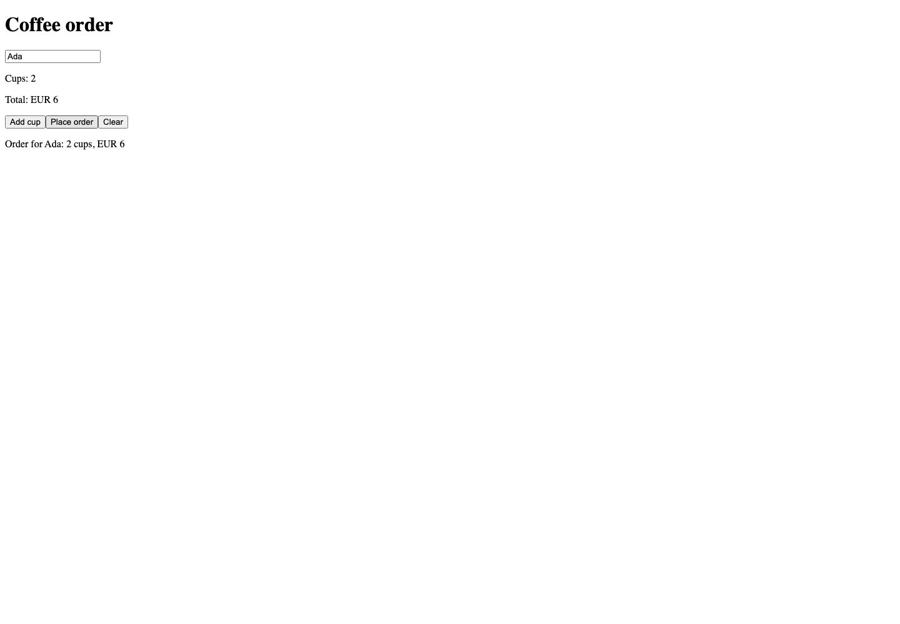
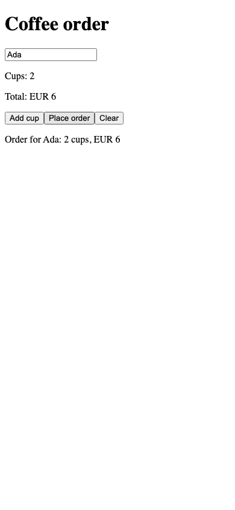

# Public first-run review

## First-user checklist

1. Repository README → **Try JTML in your browser** → homepage `#demo`.
2. **Try CoffeeOrder** opens the compiled app at `demo/coffee/`. Submit an empty
   name, enter Ada and press Enter, add a cup, submit again, then Clear.
   Expect validation, EUR 3 → EUR 6, a saved receipt and a completely reset form.
3. Return to the homepage → **Complete CoffeeOrder source**. Save the full file
   as `coffee.jtml`; the build extracts it from the existing getting-started guide.
4. **CoffeeOrder tutorial & RC.3 installation** → follow the
   [published archive/checksum instructions](../../releases/v0.3.0-rc.3.md#install-and-run-the-first-applications).
   Extract the archive and place `coffee.jtml` inside `release/`.
5. From `release/`, run the homepage commands:

   ```sh
   ./bin/jtml --version
   ./bin/jtml check coffee.jtml
   ./bin/jtml lint coffee.jtml
   ./bin/jtml build coffee.jtml --target browser --out dist/coffee
   python3 -m http.server 8000 --bind 127.0.0.1 --directory dist/coffee
   ```

6. Confirm version `jtml 0.3.0-rc.3`, open `http://localhost:8000`, repeat step 2,
   and stop the server with Ctrl+C. Python 3 is required; no Node or compiler
   toolchain is required for the downloaded CLI. Keep all generated assets together.

## Scope and visual differences

Six page URLs, the original Counter, pinned site compiler and CSP are preserved.
Only the homepage demo introduction and local-build instructions change visually.
CoffeeOrder is an additional compiled demo, not a seventh content page. It keeps
its existing minimal, unstyled form. Generated JavaScript and application markup
are copied unchanged; packaging adds title, language, viewport, CSP and link metadata.

The published screenshot archive is unchanged. Acceptance compares all five
unchanged pages in full and the homepage with only the two intentionally changed
sections (`#demo`, `#try`) hidden in both versions. New interactions, source
identity, asset hashes and screenshots cover CoffeeOrder at root and `/jtml/` paths.
The new screenshots are evidence, not replacement baselines.

## Verification

Validated on 2026-11-08, macOS 14.4.1 arm64, Python 3.12.3, Chromium
headless-shell 151.0.7922.34 and Playwright 1.63.0:

- Published primary `jtml-0.3.0-rc.3-darwin-arm64.tar.gz`, freshly downloaded and
  extracted; SHA-256 `2e4fc4fa99920015e1bc4828598a643fefd10484fe3553080b9e044f3f2ecfda`
  matches the published `SHA256SUMS`.
- Extracted executable reports `jtml 0.3.0-rc.3`; binary SHA-256
  `5d21d59d031a5f5ae16ee1c4b3f9c6de118f51589fc22db159a57c75a229a284`.
  Archive and current-guide CoffeeOrder sources are byte-identical.
- Exact commands above passed, including a Chromium interaction through the
  documented Python HTTP server. Existing `tests/browser/first_user.cjs` passed
  using the extracted binary, archive docs and archive Counter: guide/reference
  compilation, Counter, modular starter, form validation, focus, Enter, saved
  receipt, reactive total, clear and reload.
- Site registry: 13 tests; application paths: 3 tests; README/source consistency:
  passed. Site acceptance covers 1440, 900, 390 and 320px at `/` and `/jtml/`,
  strict CSP negatives, navigation, source/asset integrity, all six pages and demos.
- `verify_all.sh`: all 536 C++ tests and pre-site suites passed. Its first website
  run timed out waiting for the existing Counter Reset button to become stable.
  The unchanged website test passed on retry, including final demo metadata.
  Resuming at that test completed static HTML, package/CPack/Studio checks and
  all eight live-runtime smoke checks successfully. Final-commit hosted CI is
  recorded in the PR.

### Actual screenshots

Captured by `tests/browser/site.cjs` from the compiled `/jtml/demo/coffee/`, after
entering Ada, adding a cup and submitting. Desktop is 1440×1000; mobile viewport
is 390×844 (Chromium viewport testing, not a physical phone).




### Limitations

No deployment is included: the public site gains these changes only after a
separately approved publication. The release remains unsigned and experimental.
Fresh installation was tested on macOS arm64, not repeated on Linux in this PR.
The site still uses its existing pinned compiler `69a2cb7`; RC.3 was independently
used for local reproduction. No compiler/runtime or tutorial source changes.

The first run with desktop Chrome 156 completed form behavior but failed the
existing harness's zero-console-error assertion on an automatic favicon 404.
The same unmodified harness passed with CI-style Chromium headless-shell; this
is not a claim that desktop Chrome's console was clean. The site supplies its
own favicon and passes its console/CSP checks. Existing reference-app size and
legacy demo warnings from the full gate are not addressed by this experience change.
